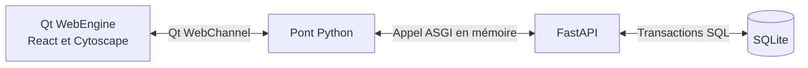

# Architecture et stack technique

[Retour au README](../README.md)

## Composants

| Composant | Rôle |
| --- | --- |
| Python et PySide6 | Gèrent le cycle de vie du programme, la fenêtre Qt et les dialogues natifs pour l'export et les sauvegardes. |
| Qt WebEngine | Exécute l'interface HTML, JavaScript et CSS à partir de ressources locales. |
| React et React DOM | Gèrent les écrans de connexion et d'accueil, les comptes et les formulaires du studio. |
| Cytoscape.js | Dessine le graphe et gère la disposition, la sélection et la navigation. |
| Qt WebChannel | Transmet les requêtes et réponses entre le JavaScript de l'interface et le code Python. |
| HTTPX et `ASGITransport` | Appellent l'application FastAPI en mémoire avec des requêtes et réponses structurées. |
| FastAPI et Pydantic | Valident les entrées, contrôlent les sessions et les droits, puis appliquent les règles de gestion. |
| SQLite et `sqlite3` | Conservent les données dans un fichier local et exécutent les modifications en transaction. |
| Node.js, npm et Vite | Installent les dépendances de l'interface et compilent ses ressources lors de la préparation. |
| PyInstaller | Prépare la distribution Windows avec le programme, Python, Qt et les ressources de l'interface. |

## Trajet d'une requête

L'interface transmet la méthode, le chemin, les paramètres et, si nécessaire,
le jeton de session. FastAPI vérifie le rôle pour le graphe demandé et lit
ou modifie SQLite. La réponse repasse par le même canal jusqu'à l'interface.
[API interne](API.md)

Le transport ASGI fonctionne sans serveur HTTP, port d'écoute ou résolution
DNS. Les ressources de l'interface sont locales. La politique de sécurité
du contenu et l'intercepteur Qt limitent les chargements aux ressources
autorisées et bloquent notamment les URL HTTP et HTTPS, y compris localhost.

## Données

SQLite conserve les comptes dans `users`, les jetons hachés dans `sessions`
et les droits dans `graph_permissions`. `graphs` identifie chaque graphe et
contient son nom et ses métadonnées. Les tables `persons` et `relations`
contiennent les fiches et les liens, rattachés à leur graphe par `graph_id`.
La relation entre un compte et un graphe porte le rôle. Le rôle global
d'administration des comptes est stocké avec le compte.

Les liens d'entreprise font partie de la transaction qui modifie les
personnes. Un import applique l'ensemble des changements dans une transaction
et annule le tout si une validation échoue. Les échanges avec le web passent
par le format JSON d'un graphe.
[Configuration et données](CONFIGURATION.md)

Références Qt pour approfondir le transport et le déploiement.
[WebChannel](https://doc.qt.io/qtforpython-6/overviews/qtwebchannel-javascript.html),
[interception des requêtes](https://doc.qt.io/qt-6/qwebengineurlrequestinterceptor.html),
[déploiement de Qt WebEngine](https://doc.qt.io/qt-6/qtwebengine-deploying.html).
